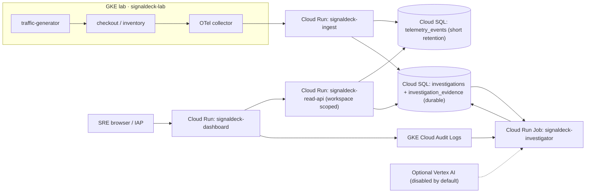

# SignalDeck architecture and release gates

## End goal

An SRE investigation platform that detects symptoms, retrieves supporting application and infrastructure evidence, explains the actual failure mechanism, identifies the initiating change when a record exists, and recommends an immediate recovery, permanent correction, and evidence-backed validation. It must distinguish **observed facts**, **working hypotheses**, **corroborated mechanisms**, and **unknown upstream intent**. A model must never automatically modify infrastructure or declare a root cause verified without independent evidence.

## Service diagram

**Project safety:** The `signaldeck-lab-kd` Google Cloud project also hosts user-facing Spacical infrastructure. Never turn off the project, unrelated Cloud Run services, or Cloud SQL unless service dependencies are verified.

## Functional acceptance

See the [live pilot checkpoints](CODEX_HANDOFF.md) for completed release verification. The table lists release gates and follow-up coverage.

| Feature | Source code | Release gates and follow-up coverage |
|---|---|---|
| Real distributed tracing | Existing application + collector | Fresh lab traces, parent-child spans, sampling coverage |
| Kubernetes state | Existing collector and dashboard | Watch-mode Deployment snapshots and Event coverage |
| Error-based Alerts UI | Existing dashboard | Configurable rule policy; delivery channel not selected |
| Live service correlation | Existing heuristic engine | Error injection, false-positive tests, timeline proof |
| Historical GKE audit investigation | Existing dashboard | Audit read role, evidence retention |
| Durable failure evidence archive | Milestone 3 schema + ingest | Apply migration 003; DB roles; opt-in flag; fresh failure |
| Saved investigation UI | Read API + dashboard | Read API schema/permissions + workspace isolation in Cloud Run |
| Initiating GKE scale audit enrichment | New separate investigator job | Least-privilege identity, Cloud Logging permissions, Cloud SQL network, periodic job configuration |
| Evidence-grounded remediation | New deterministic rules | Multi-event integration and blinded SRE review |
| Optional Vertex AI analysis | New analyst module | Model/region choice, Vertex IAM, PII policy, quota and budget; disabled by default |
| Pilot incident alerts | IAP-protected Alerts inbox sourced from the saved archive | Verify one alert per investigation, durable shared acknowledgement, and evidence links |
| Draft postmortems | Download from a saved investigation | Verify original source IDs, confidence boundaries, and workspace scope |
| Production SaaS tenancy & billing | Not complete | Independent tenant identities, RLS/authorization, PII/retention, billing and security reviews |

Passing CI only establishes that syntax, build and tests succeed in disposable environments. It does **not** establish all runtime services are deployed or the complete product is production-ready.

## Repository validation

`.github/workflows/product-validation.yml` runs:
1. Node syntax checks for read API, ingestion service, and investigator;
2. archive fixture tests and evidence grounding tests;
3. TypeScript checks and the Next.js build;
4. disposable PostgreSQL 16 migrations (001 and 003 twice), replay deduplication and cross-tenant evidence FK check;
5. read API authentication and archived evidence retrieval.

## Deployment prerequisites (explicit human/authorized Work handoff)

- Review database backup and apply migrations with an authorized Cloud SQL role.
- Verify writer/read-only DB role separation and actual PostgreSQL privileges.
- Deploy read API, ingestion service and dashboard with existing Cloud Run auth and secret mappings.
- Set archive flag **only after** schema/privilege checks. Keep `SIGNALDECK_ARCHIVE_ENABLED=false` by default.
- Create a separate investigator service account with **Cloud Logging read-only** and narrowly scoped Cloud SQL writes, then deploy/run the Cloud Run Job.
- The first provider smoke test uses the bundled synthetic incident. Run `npm --prefix cloud-run-investigator run trial:ai` with Application Default Credentials and explicit `SIGNALDECK_GCP_PROJECT_ID` and `SIGNALDECK_VERTEX_MODEL`. Set `SIGNALDECK_VERTEX_REGION` to a supported endpoint (the trial defaults to `us`). This command makes one model request and has no archive database connection.
- Enable `SIGNALDECK_AI_ENABLED=true` and a validated model only after reviewing sensitive data policy and a Vertex AI spending limit. The application limits to 2 model analyses per job execution, but a recurring schedule requires an external budget safeguard.
- Confirm a controlled new failure remains reconstructable after the raw telemetry record expires.
- Do not deploy with a broad public allow-unauthenticated permission or use the GKE collector's ingestion key for privileged evidence analysis.

## Structured application evidence

An instrumented application can record response handling as an OTLP error log on the incoming server span. Send the original trace and span IDs with `signaldeck.event.name=dependency_error_mapped_to_http_response`, integer `signaldeck.dependency.status_code`, and integer `http.response.status_code`. The archive keeps the two validated HTTP codes. The investigator matches the log to a server span and a single direct dependency span in the same archived investigation. The timestamps and HTTP codes must agree.

The model selects typed observations and cites a source for each one. SignalDeck renders and saves those observations from the cited facts, with the original archive IDs. The response mapping cites the log and both spans. The cause of the dependency response remains unknown until independently established. Recovery and prevention suggestions are labeled as proposals.

For a controlled Cloud Run execution, use `job.js --analyze-incident <uuid>` with AI explicitly enabled for that execution. The job reads one eligible application investigation in the configured workspace and saves its validated analysis.

## Pilot incident alerts and postmortems

The Alerts page presents the latest 30 saved investigations as in-app notifications. The investigation ID is the alert identity. Ingest creates investigations and evidence in the same transaction, so a replay keeps the existing alert and its acknowledgement. The live error sample is still shown separately on the page.

An acknowledgement is shared by responders in the pilot workspace. Apply `006_investigation_acknowledgements.sql` after migrations 003 and 005. The existing dashboard incident-writer role can read and insert receipts, with no update or delete permission on them. The workspace and investigation foreign key must match, and the server action takes its workspace from configuration. The dashboard continues to display archived evidence links if the receipt store is unavailable.

The saved investigation page downloads a Markdown draft with the original evidence IDs, Central Time timestamps, and the archived confidence and follow-up fields. Exports are fetched through the workspace-scoped read API. They omit raw evidence payloads and label the document as a draft. This pilot channel is in-app. Any external delivery worker needs a separately configured receiver and delivery state.

## Cloud cost policy

Do not confuse `min-instances=0` with fully stopped infrastructure. Cloud SQL compute and GKE management/node/pod billing can continue. For a safe low-impact pause, `scripts/pause-signaldeck-lab-safe.ps1` stops only the lab traffic generator with `-Apply`. For a fuller pause, `lab-stop.ps1 -Apply` records all SignalDeck-only deployment replica counts then scales those deployments to zero, without resizing or deleting GKE nodes; `lab-start.ps1 -Apply` restores from the saved local state. Stopping `signaldeck-db` requires the additional explicit `-StopCloudSql` flag after confirming that no Spacical service depends on it. Consult Cloud Billing and verify Spacical service dependencies before stopping a database or cluster. No automated shutdown was applied by this branch.

## Release state

The IAP-protected internal pilot is live. The latest revisions, lab results, and rollback points are recorded in the [handoff](CODEX_HANDOFF.md).
